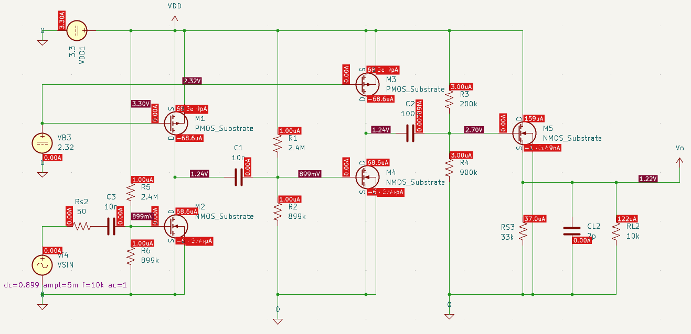
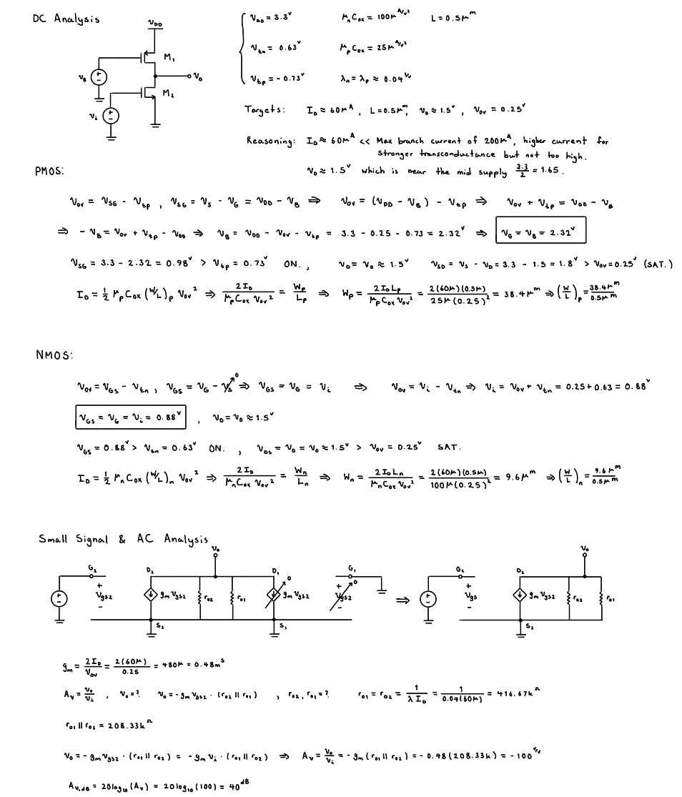
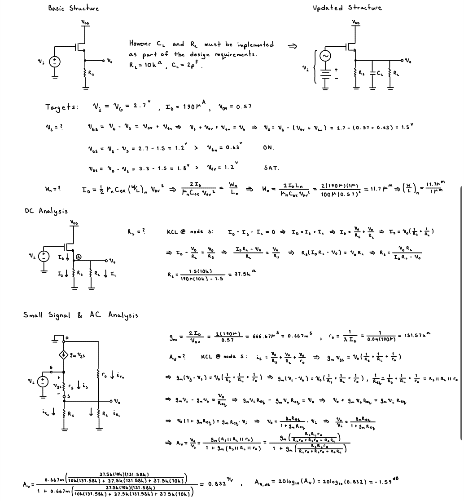
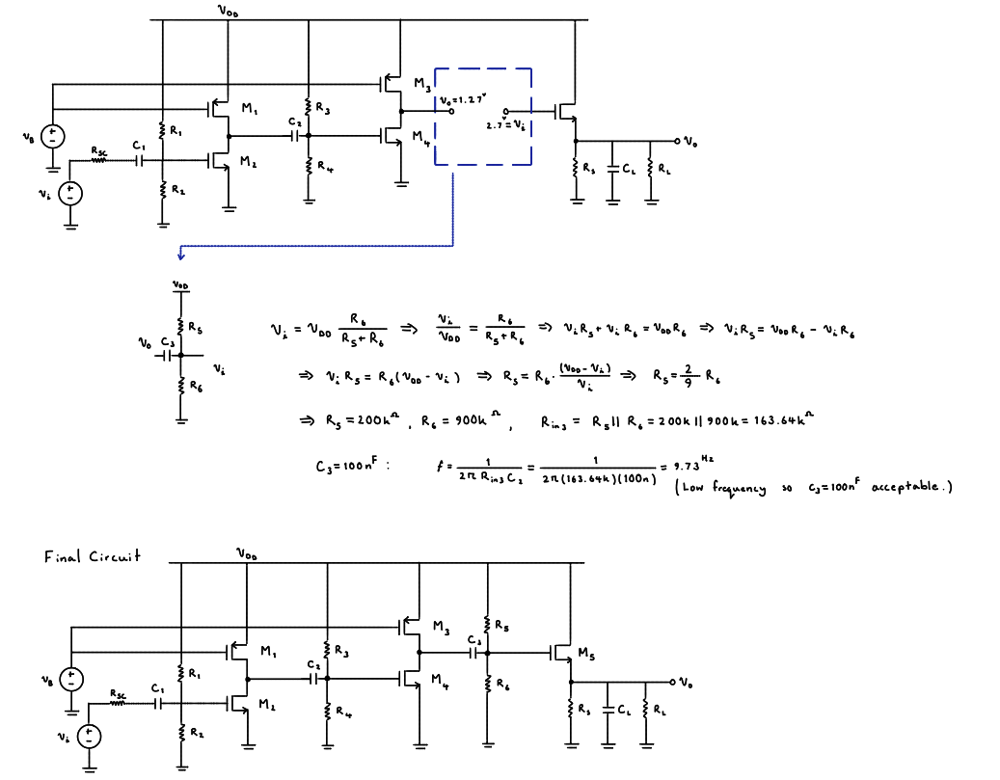
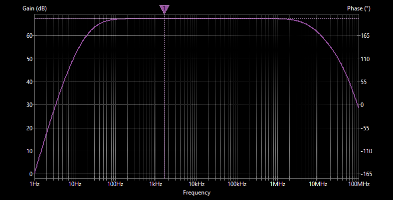
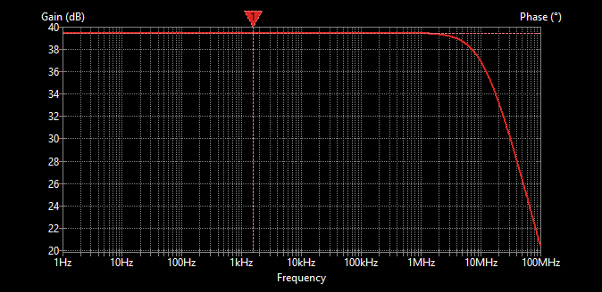
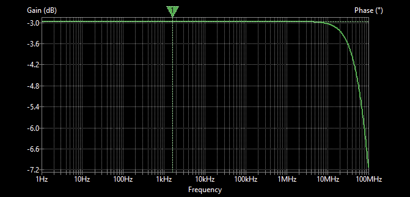
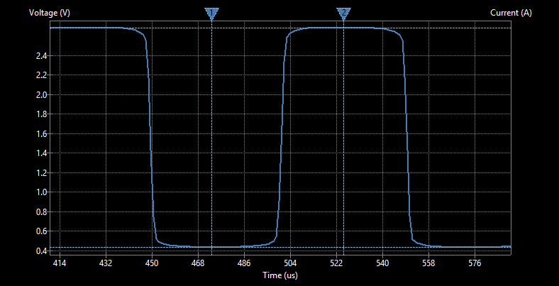

# Three-Stage MOSFET Amplifier Design

**ELE 404 — Electronic Circuits I | Toronto Metropolitan University | Winter 2026**

A three-stage, open-loop CMOS voltage amplifier designed from transistor-level calculations and verified using SPICE simulation. The design combines **two common-source gain stages** with a **common-drain (source-follower) output buffer** to balance voltage gain, bandwidth, and load-driving capability under a 3.3 V supply and a strict power budget.

> **Project scope:** This is a **simulation-based circuit design**, not a fabricated or breadboard-tested amplifier. The analysis and figures below come from my ELE 404 project report.

## Design requirements

The amplifier was developed against the following course specifications:

| Parameter | Required value |
| --- | ---: |
| Supply voltage | 3.3 V (single supply) |
| Total open-loop gain, unloaded | ≥ 60 dB (1,000 V/V) |
| Gain per stage | ≤ 40 dB (unless justified) |
| −3 dB bandwidth | ≥ 500 kHz |
| Input signal amplitude | ≤ 10 mVpp |
| Input resistance | ≥ 100 kΩ |
| Source resistance | 50 Ω |
| Load resistance | 10 kΩ |
| Load capacitance | 2 pF |
| Output swing | ≥ 1.5 Vpp |
| Gain reduction with load | ≤ 10% |
| Total DC power | ≤ 1 mW |
| Maximum branch current | ≤ 200 µA |

The assignment used NMOS and PMOS models with a permitted channel-length range of 0.5–5 µm. The recommended overdrive-voltage range was 0.2–0.6 V.

## Architecture and design decisions

### Stages 1 and 2 — Common-source voltage amplification

The first two stages use common-source amplifier configurations to build the voltage gain needed to reach the overall ≥60 dB target. The second stage reuses the first stage's design, with AC coupling between stages. Hand calculations were used to select transistor dimensions and bias conditions, estimate transconductance and small-signal gain, and check saturation-region operation.

### Stage 3 — Common-drain output buffer

The final stage is a source follower. Rather than contributing substantial voltage gain, it provides a lower output resistance so the amplifier can drive the specified **10 kΩ / 2 pF** load without excessive gain loss.

A key trade-off arose in this stage: the final design used an **overdrive voltage above the recommended range** to improve output drive. The report explicitly identifies this exception; it should not be described as meeting *every* design guideline. The reported branch currents remained within their limits.

### Biasing and AC coupling

The design uses bias networks and coupling capacitors to establish suitable DC operating points while passing the input signal between stages. Each stage was analyzed separately before the full circuit was simulated.

## Simulation and verification

The design process combined manual calculations with DC and AC SPICE analyses. The complete circuit was also checked using transient analysis for output swing.

### Frequency response

The final amplifier's simulated AC response shows the combined effect of the three stages, including the low-frequency roll-off associated with coupling and the high-frequency roll-off that determines the upper bandwidth limit.

Individual-stage frequency responses

**Common-source stages**

**Source-follower stage**

### Output swing

Transient simulation was used to inspect the output waveform and evaluate the output-swing requirement.

### Reported outcome

The project report concludes that the final amplifier met the specified overall gain, minimum bandwidth, and output-swing targets, with an output swing **greater than 1.5 V**. It also reports that transistors remained biased in saturation and branch currents were within the required limits. The **Stage 3 overdrive recommendation was exceeded intentionally** as a load-drive trade-off.

The report includes theoretical-versus-simulation comparisons, but its table values are not reliably available as text here. For that reason, this README does **not** invent precise simulated gain, bandwidth, power, or percentage-error figures. Those can be added later from the original simulation outputs.

## Engineering takeaways

- **Architecture matters:** Two gain stages and a separate output buffer serve different performance objectives.
- **Biasing and sizing are interconnected:** Device dimensions, drain current, overdrive voltage, and small-signal parameters influence gain and operating region.
- **Loading changes the design problem:** A high-gain stage alone is not necessarily suitable for driving the specified load.
- **Trade-offs must be documented:** Improving output drive came at the expense of exceeding the recommended Stage 3 overdrive range.
- **Verification is essential:** Stage-level analysis and full-circuit SPICE simulation were used to evaluate the proposed design against its constraints.

## Project files

- [`assets/`](assets/) — circuit schematic, hand-calculation images, and simulation plots extracted from the project report.
- **Full project report:** Add a PDF export of the report to the repository and link it here if you want readers to inspect the complete calculations and discussion.
- **SPICE source files:** Add the original schematic/netlist and model files if you have them, so others can reproduce the simulation.

## Tools and concepts

**Tools:** SPICE circuit simulation, schematic capture, analytical circuit calculations  
**Concepts:** CMOS analog design, common-source amplifiers, source followers, DC biasing, MOSFET saturation, small-signal gain, AC coupling, frequency response, transient analysis, power and load constraints

---

*Academic design project completed for ELE 404 (Electronic Circuits I), Winter 2026.*
